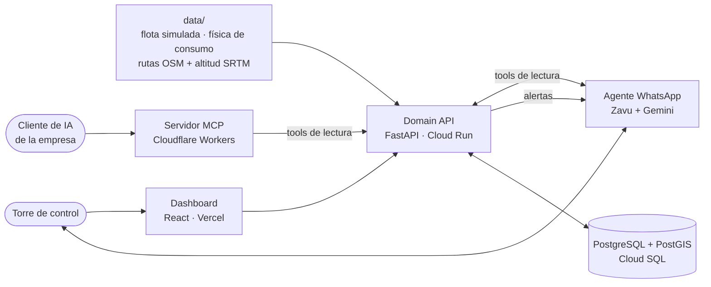

<h1 align="center">Certera</h1>

<p align="center">
  Telemetría con la pendiente de la ruta: un agente que avisa antes de que el camión se quede sin diésel en los Andes.
</p>

<p align="center">
  <a href="https://certera-landing.vercel.app">Landing</a> ·
  <a href="https://certera-dashboard.vercel.app">Dashboard</a> ·
  <a href="#cómo-funciona">Cómo funciona</a> ·
  <a href="#arquitectura">Arquitectura</a> ·
  <a href="#desarrollo">Desarrollo</a> ·
  <a href="CONTEXT.md">Glosario</a>
</p>

---

## El problema

Las plataformas de gestión de flotas calculan el consumo y el desgaste como si el terreno fuera plano. En los Andes un
camión sube de 0 a 4 800 msnm en pocas horas. Sin ese contexto físico, los camiones se quedan sin combustible en
zonas remotas o recalientan el motor, y cada camión varado cuesta grúa, reprogramación y penalidades.

## La propuesta

En vez de un modelo de caja negra que necesita meses de historia, un **agente de IA con herramientas** que razona como
un analista: cruza la telemetría del camión con la ruta que le falta y con lo que reportan los choferes, explica
cada alerta con evidencia y mantiene a una persona en el circuito por WhatsApp.

| Dimensión | Qué aporta | Estado |
|---|---|---|
| **Telemetría** | Consumo, velocidad, motor y paradas de cada vehículo | ✅ Flota simulada sobre carreteras reales de Perú |
| **GPS y ruta** | Posición, corredor, tramo y sentido; altitud real de cada tramo (SRTM) | ✅ |
| **Comparación con pares** | Consumo esperado del tramo según la flota que lo recorrió en el mismo sentido | ✅ Una subida a Ticlio no dispara falsas alarmas |
| **Chofer por WhatsApp** | Reportes que explican una parada o un gasto | ✅ Texto por webhook · 🔜 notas de voz y preguntas proactivas |
| **Topografía futura** | Combustible restante frente a la pendiente que falta | 🔜 Hoy se detecta el sobreconsumo; anticiparlo es el siguiente paso |

**Ejemplo (ilustrativo).** El T-04 sale de Chosica hacia La Oroya con 30 galones y 30 t. Le faltan unos 100 km de
subida hasta Ticlio. Con el consumo de llano llegaría sobrado; con la pendiente se queda sin diésel antes de la
cumbre. Alerta a la torre de control: *"El T-04 no llega a Ticlio. Abastecer 40 galones en San Mateo."*

**Por qué se paga sola (estimación, sin validar con clientes).** Un camión varado cuesta entre **US$ 500 y 2 000**
en grúa, reprogramación y penalidades. La meta de costo operativo es **menos de US$ 3 al mes por camión**, porque
la IA solo razona cuando las reglas detectan una anomalía. Evitar un solo evento cubre la plataforma.

## Cómo funciona

1. **Reglas primero.** La Domain API reproduce la telemetría y compara cada pasada con la línea base de su tramo y
   sentido. Sobreconsumo = ≥ 1,25 × la mediana y por encima del p90 de los pares.
2. **El agente explica.** Ante una anomalía sale una alerta por WhatsApp. El gestor pregunta "¿por qué?" y el agente
   responde con las tools de la API, separando **hechos** de **hipótesis**.
3. **La persona valida.** El reporte del chofer ("estuvimos esperando para descargar") se cruza con los sensores y
   queda junto a la alerta.

**La demo** usa casos guionados y deterministas: sobreconsumo de T07 en Lima–Arequipa, ralentí de T04 al dormir con el
motor prendido, una parada sin explicar de T28 y la subida de T22 a Ticlio con carga completa, que **no** genera
alerta porque sus pares consumen lo mismo.

> **Toda respuesta declara de dónde sale el dato.** La telemetría, los fletes y los conductores son simulados
> (`synthetic_demo`) sobre carreteras reales de Perú. La línea base la calcula el sistema (`model_inferred`) y los
> mensajes del chofer son `human_reported`. La demo nunca dice "telemetría real".

## Arquitectura



| Pieza | Carpeta | Qué hace |
|---|---|---|
| Domain API | [`backend/`](backend/) | Replay, línea base, anomalías, alertas, cuellos de botella y fletes. Única pieza con lógica y base. Contrato en [`openapi.json`](backend/openapi.json) |
| Datos | [`data/`](data/) | Genera la flota sobre 4 corredores reales con un modelo físico calibrado con [FEAD](https://github.com/Torreskai0722/FEAD) |
| Agente | [`zavu/`](zavu/) | WhatsApp del gestor: alertas y preguntas en español con las tools de lectura |
| MCP | [`mcp/`](mcp/) | 6 tools de **solo lectura** y una de control del replay, para que la IA de la empresa consulte la flota sin tocar la base |
| Dashboard | [`dashboard/`](dashboard/) | Mapa del replay, vehículos, alertas, consumo por tramo y fletes en soles |
| Landing | [`web/`](web/) | Página estática del producto |

**Seguridad.** El agente no ejecuta SQL: solo llama a tools con alcance acotado. Las tools, el webhook y el control
del replay exigen `X-API-Key`; los secretos viven en Secret Manager, Workers y Zavu, nunca en el repo.

## Desarrollo

Requisitos: Python ≥ 3.12 con [`uv`](https://docs.astral.sh/uv/), Node.js ≥ 20 y Docker (los tests del backend
levantan PostGIS).

```bash
make setup                    # dependencias de todas las carpetas + Chromium de Playwright
make test                     # todas las capas que no necesitan URLs públicas
backend/scripts/mock-api.sh   # Domain API simulada desde el contrato, en :4010
cd dashboard && npm run dev   # dashboard contra la API simulada
```

Reglas del equipo: un ticket = una rama, se mergea a `main` solo con los tests en verde, y los tests verifican
comportamiento externo (HTTP y lo que ve el usuario). Detalle en [`docs/dev/README.md`](docs/dev/README.md).

## Documentación

- Glosario del dominio: [`CONTEXT.md`](CONTEXT.md)
- Decisiones de arquitectura: [`docs/adr/`](docs/adr/) · decisiones de producto: [`validacion-producto-decisiones.md`](docs/research/validacion-producto-decisiones.md)
- Tickets del MVP: spec [#4](https://github.com/npm-devs/npm-devs/issues/4) y [`mapa-dependencias.md`](docs/dev/mapa-dependencias.md)

## Equipo

[Joseph Robles](https://github.com/JosephRobles23) (coordinación, infraestructura, agente, MCP) ·
[Juan Montreuil](https://github.com/JuanMontreuil08) (datos, Domain API) ·
[Lian Pinto](https://github.com/KevinPinto123) (dashboard) ·
[Ismael Rojas](https://github.com/Ismaelrojas0112) (landing).
Proyecto de The Andes Hackathon, octubre de 2026.

Rutas © colaboradores de OpenStreetMap (ODbL); altitud SRTM (dominio público). El repo no redistribuye datos crudos
de FEAD. El código aún no tiene licencia publicada.
