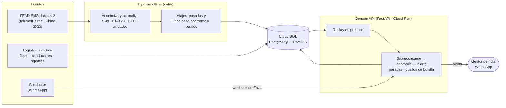
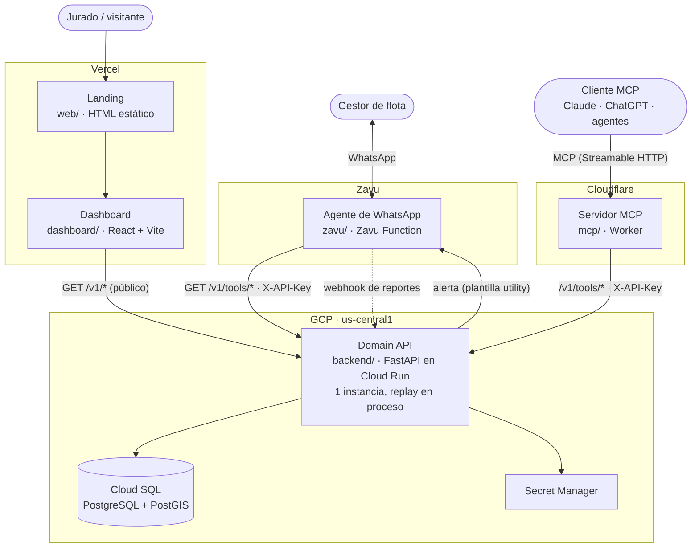
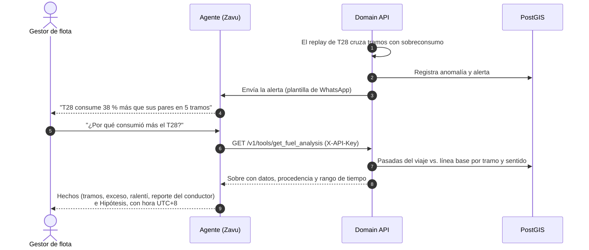

<h1 align="center">Fleet Intelligence</h1>

<p align="center">
  Sabe por qué tu flota gasta más combustible, antes de que cueste.
</p>

<p align="center">
  <a href="https://fleet-intelligence-dashboard.vercel.app">Dashboard</a> ·
  <a href="#cómo-funciona">Cómo funciona</a> ·
  <a href="#arquitectura">Arquitectura</a> ·
  <a href="#la-demo">La demo</a> ·
  <a href="#desarrollo">Desarrollo</a> ·
  <a href="CONTEXT.md">Glosario</a>
</p>

<p align="center">
  
  
  
  
  
  
  
</p>

---

Fleet Intelligence es inteligencia operacional para flotas de **transporte troncal de larga distancia**. Sigue a cada
vehículo en su corredor, detecta **sobreconsumo de combustible comparándolo con sus pares en el mismo tramo y
sentido**, explica la causa probable con evidencia y avisa al **gestor de flota por WhatsApp**. El gestor puede
preguntarle al agente por WhatsApp, o desde cualquier cliente MCP, "¿por qué consumió más?" o "¿qué cuellos de
botella hay en mis fletes activos?".

> **Principio rector: toda respuesta declara de dónde sale el dato.** La telemetría es real (FEAD, una flota en
> China, abril de 2020) y se **reproduce**, no llega en vivo. Los fletes, conductores y mensajes son sintéticos y
> están marcados como tales. Ninguna pantalla ni respuesta del agente mezcla las dos cosas sin decirlo.

Proyecto de The Andes Hackathon (octubre de 2026). La spec del MVP es el issue
[#4](https://github.com/npm-devs/npm-devs/issues/4).

## Tabla de contenidos

- [Características](#características)
- [Cómo funciona](#cómo-funciona)
- [Arquitectura](#arquitectura)
- [Procedencia y modelo de seguridad](#procedencia-y-modelo-de-seguridad)
- [La demo](#la-demo)
- [Desarrollo](#desarrollo)
- [Estructura del repositorio](#estructura-del-repositorio)
- [Estado](#estado)
- [Documentación](#documentación)
- [Equipo](#equipo)
- [Datos y licencia](#datos-y-licencia)

## Características

- **Replay de telemetría real**: registros de FEAD EMS dataset-2 (motor, combustible y GPS de 28 tractocamiones)
  reproducidos con velocidad configurable, pausa y salto, y con resultados deterministas
  ([ADR 0001](docs/adr/0001-telemetria-por-replay-de-fead.md)). Se conservan por separado la hora original del
  evento y la hora de emisión simulada.
- **Línea base por tramo y sentido entre pares**: el consumo de cada pasada se compara con la mediana y el p90 de
  toda la flota en esa misma celda H3 y sentido, no con el promedio del propio vehículo. Así una subida larga no
  dispara falsas alarmas ([ADR 0002](docs/adr/0002-linea-base-por-tramo-y-sentido-entre-pares.md),
  [0008](docs/adr/0008-tramos-como-celdas-h3.md), [0009](docs/adr/0009-linea-base-offline-con-toda-la-flota.md)).
- **Sobreconsumo, anomalía y alerta**: una pasada con sobreconsumo es ≥ 1,25 × la mediana y supera el p90. Varios
  tramos seguidos con un exceso ≥ 3 L forman una anomalía, que genera una alerta con evidencia (máximo 1 por
  vehículo cada 60 min de hora del evento).
- **Cuellos de botella**: tiempo perdido en paradas sin explicar (≥ 10 min) o en ralentí prolongado, ordenado por
  impacto. Una parada que el conductor explicó deja de ser un cuello de botella, pero sigue visible.
- **Agente de WhatsApp vía Zavu**: el gestor consulta la flota en español. El agente separa *Hechos* de
  *Hipótesis*, declara la procedencia y la hora (UTC+8) y aclara que es un replay. Los reportes del conductor
  entran por webhook y se guardan con su texto original
  ([ADR 0007](docs/adr/0007-reportes-del-conductor-por-webhook.md)).
- **Servidor MCP en Cloudflare** con 7 tools: `get_fleet_overview`, `get_vehicle_status`, `get_trip_status`,
  `get_fuel_analysis`, `get_operational_bottlenecks`, `get_alerts` y `control_replay`
  ([mcp/](mcp/README.md)).
- **Dashboard** de una sola página: barra de replay, mapa MapLibre con la posición de cada vehículo, lista de
  vehículos y viajes, alertas y consumo por tramo frente a los pares, con etiquetas de procedencia en cada vista
  ([dashboard/](dashboard/README.md)).
- **Landing** estática con el caso T07 (subiendo la cordillera de Nanling sin generar una falsa alarma) como
  diferenciador ([web/](web/README.md)).

## Cómo funciona



El pipeline de `data/` convierte FEAD en datos anónimos y calcula la línea base **offline** con los 28 vehículos. A la
base solo llega el agregado. La Domain API reproduce la telemetría de los 6 vehículos de la demo, detecta las
anomalías al vuelo y las registra como alertas que salen por WhatsApp.

## Arquitectura

### Vista de componentes



| Componente | Tecnología | Qué hace |
|---|---|---|
| **Domain API** (`backend/`) | Python 3.12, FastAPI, Cloud Run | Única pieza con lógica de negocio y única que toca la base. Contrato en [`backend/openapi.json`](backend/openapi.json) |
| **Base** | Cloud SQL, PostgreSQL 16 + PostGIS | Vehículos, viajes, telemetría, pasadas, línea base, alertas y reportes ([ADR 0003](docs/adr/0003-cloud-sql-postgis-como-unico-almacen.md)) |
| **Pipeline de datos** (`data/`) | Python, uv | Descarga, anonimiza y normaliza FEAD; calcula viajes, pasadas y línea base; genera la logística sintética |
| **Servidor MCP** (`mcp/`) | Cloudflare Workers, `agents`, MCP SDK v2 | Adaptador delgado y sin estado de la Domain API ([ADR 0004](docs/adr/0004-mcp-en-cloudflare-y-tools-de-zavu-por-http.md)) |
| **Agente** (`zavu/`) | Zavu Function, Gemini | Agente de WhatsApp del gestor con las 6 tools de lectura |
| **Dashboard** (`dashboard/`) | React 19, Vite, MapLibre, Recharts | Pantalla de la flota con polling cada 2 s ([ADR 0010](docs/adr/0010-dashboard-en-react.md)) |
| **Landing** (`web/`) | HTML + CSS + Canvas, sin build | Presenta el producto y enlaza al dashboard ([ADR 0011](docs/adr/0011-frontends-en-vercel.md)) |

Todas las respuestas de la Domain API van en un mismo sobre:

```json
{ "data": {}, "provenance": ["fead_observed"], "time_range": {"from": "...", "to": "..."}, "updated_at": "...", "is_replay": true }
```

### Una pregunta por WhatsApp



Las cifras del mensaje de ejemplo son ilustrativas.

## Procedencia y modelo de seguridad

- **Procedencia en cada dato.** `fead_observed` (telemetría real reproducida), `synthetic_demo` (fabricado para la
  demo), `human_reported` (escrito por una persona), `external_enrichment` y `model_inferred`. La declaran la API,
  el dashboard, el agente y el MCP.
- **Datos anónimos.** Los vehículos son `T01`…`T28`. El pipeline descarta IMEI, matrículas, hashes y direcciones, y
  falla si detecta alguno en la salida (`data/fleetdata/pii.py`). La tabla de alias vive fuera del repo.
- **Lecturas públicas, escrituras con llave.** El dashboard lee `/v1/*` sin login porque los datos son anónimos.
  Las tools del agente y del MCP, el webhook de reportes y el control del replay exigen `X-API-Key`. El dashboard le
  pide la llave al presentador solo para controlar el replay y la guarda en `sessionStorage`.
- **El agente no ejecuta SQL.** Solo llama a las tools de la Domain API, cada una con su propio alcance.
- **Secretos** en Secret Manager (GCP), en los secrets del Worker y en los de Zavu. Nunca en el repositorio.

## La demo

1. **Landing → dashboard.** La landing presenta el problema y el caso T07, y enlaza al dashboard.
2. **Demo A · sobreconsumo (T28).** El replay avanza. El dashboard marca la anomalía y llega la alerta por WhatsApp.
   El gestor pregunta "¿por qué?" y recibe la evidencia por tramo.
3. **Contraste (T07).** El T07 sube la cordillera de Nanling, consume más y **no** genera alerta, porque sus pares
   consumen lo mismo en ese tramo y sentido.
4. **Demo B · cuellos de botella.** "¿Qué cuellos de botella hay en mis fletes activos?" devuelve un ranking con T22
   y T04, distinguiendo hechos de hipótesis.

El recorrido completo se verifica con Playwright contra las URLs públicas en [`e2e/`](e2e/README.md) (ticket
[#26](https://github.com/npm-devs/npm-devs/issues/26)).

## Desarrollo

### Requisitos

- Python ≥ 3.12 y [`uv`](https://docs.astral.sh/uv/).
- Node.js 20 o superior y npm.
- Docker corriendo (los tests del backend levantan PostgreSQL + PostGIS con testcontainers).
- Para el agente: acceso al proyecto de Zavu y `npx zavudev login`.
- Para desplegar: `gcloud` (backend), `wrangler` (MCP, se instala con el paquete) y Vercel (frontends).

### Puesta en marcha

```bash
git clone https://github.com/npm-devs/npm-devs.git
cd npm-devs
make setup                    # dependencias de todas las carpetas + Chromium de Playwright
make test                     # todas las capas que no necesitan URLs públicas

backend/scripts/mock-api.sh   # Domain API simulada (Prism) en http://127.0.0.1:4010
cd dashboard && npm run dev   # dashboard contra el simulado
```

El simulado sale del contrato OpenAPI, así que el dashboard, el MCP y el agente se pueden desarrollar sin la base.

### Comandos

| Comando | Qué hace |
|---|---|
| `make setup` | Instala dependencias (uv y npm) en todas las carpetas. Hace falta en cada worktree nuevo |
| `make test` | Corre backend, data, mcp, zavu, dashboard y web |
| `make test-backend` | pytest + httpx contra la API, con PostGIS en Docker |
| `make test-data` | Pipeline de datos con un tar sintético, sin datos reales |
| `make test-mcp` / `make test-zavu` | `tsc` + vitest (MCP dentro del runtime de Workers; Zavu contra Prism) |
| `make test-dashboard` / `make test-web` | Playwright sobre el build y la landing |
| `make test-e2e` | Flujo de la demo contra las URLs públicas (`E2E_API_URL`, `E2E_DASHBOARD_URL`, `E2E_LANDING_URL`) |
| `tools/verify-ticket.sh <worktree>` | Corre los tests de las carpetas que cambió una rama |
| `tools/orquestar.sh` | Sesión con el agente orquestador que implementa tickets |

Cada carpeta tiene su propio check en GitHub Actions.

### Convenciones

- **Un ticket = una rama = un worktree.** Sin PRs: la rama se mergea a `main` en local cuando los tests pasan.
  Detalle en [`docs/dev/README.md`](docs/dev/README.md).
- **Ningún ticket se cierra sin un test que cubra su criterio de aceptación**, y **nunca se mergea a `main` con
  tests en rojo**.
- **Los tests verifican comportamiento externo** (HTTP, lo que ve el usuario). El punto de prueba principal es la
  Domain API. MCP y Zavu se prueban contra el contrato OpenAPI.
- **El contrato manda.** El dashboard, el MCP y el agente consumen el backend solo a través de
  `backend/openapi.json`. Un cambio de contrato va en su propio ticket.
- **Vocabulario del dominio** en [CONTEXT.md](CONTEXT.md): vehículo, viaje, flete, tramo, pasada, cuello de
  botella… Se usa en código, docs y UI.

La guía para agentes está en [CLAUDE.md](CLAUDE.md).

## Estructura del repositorio

```text
backend/     Domain API (FastAPI): replay, línea base, alertas, cuellos de botella; contrato openapi.json
data/        pipeline FEAD → datos anónimos de la demo, línea base offline y logística sintética
mcp/         servidor MCP en Cloudflare Workers con las 7 tools
zavu/        agente de WhatsApp (Zavu Function) y plantillas de alerta
dashboard/   dashboard React + Vite + MapLibre
web/         landing estática y tokens de diseño (assets/tokens.css)
e2e/         Playwright del flujo de la demo contra los despliegues públicos
simulator/   simulador visual de pendiente y combustible
tools/       orquestador, verificación de tickets, hooks, wizard de GCP, atajos de Zavu
docs/        producto, ADRs, research, marca y coordinación del equipo
```

## Estado

MVP en construcción. Los 22 tickets son sub-issues de la spec [#4](https://github.com/npm-devs/npm-devs/issues/4), y
el orden y las dependencias están en [`docs/dev/mapa-dependencias.md`](docs/dev/mapa-dependencias.md). Ya cerrados:
harness de tests y CI, infraestructura GCP, dataset anónimo, contrato OpenAPI y agente de Zavu.

## Documentación

| Tema | Dónde |
|---|---|
| Contexto de producto | [`docs/product/PRODUCT_CONTEXT_FLEET_INTELLIGENCE.md`](docs/product/PRODUCT_CONTEXT_FLEET_INTELLIGENCE.md) |
| Glosario del dominio | [`CONTEXT.md`](CONTEXT.md) |
| Decisiones de arquitectura | [`docs/adr/`](docs/adr/) (ADR 0001…0011) |
| Decisiones del grilling (D1…D35) | [`docs/research/validacion-producto-decisiones.md`](docs/research/validacion-producto-decisiones.md) |
| Perfil de FEAD y del piloto | [`docs/research/fead-ems-dataset2-perfil.md`](docs/research/fead-ems-dataset2-perfil.md), [`fead-perfil-piloto.md`](docs/research/fead-perfil-piloto.md) |
| WhatsApp con Zavu | [`docs/research/zavu-whatsapp-capacidades.md`](docs/research/zavu-whatsapp-capacidades.md) |
| Flujo de trabajo y orquestador | [`docs/dev/README.md`](docs/dev/README.md) |
| Sistema visual | [`docs/brand/IDENTIDAD-VISUAL.md`](docs/brand/IDENTIDAD-VISUAL.md) |
| Rúbrica de evaluación | [`docs/rubrica-evaluacion.md`](docs/rubrica-evaluacion.md) |

## Equipo

| Persona | GitHub | Área |
|---|---|---|
| Joseph Robles | [@JosephRobles23](https://github.com/JosephRobles23) | Coordinación, infraestructura GCP, Zavu, agente, MCP, alertas, e2e |
| Juan Montreuil | [@JuanMontreuil08](https://github.com/JuanMontreuil08) | Datos FEAD, replay, Domain API, línea base |
| Lian Pinto | [@KevinPinto123](https://github.com/KevinPinto123) | Dashboard |
| Ismael | [@Ismaelrojas0112](https://github.com/Ismaelrojas0112) | Landing |

## Datos y licencia

El repositorio **no contiene datos crudos de FEAD**: solo scripts de descarga y procesamiento y un fixture chico
anonimizado ([ADR 0006](docs/adr/0006-datos-de-china-sin-reproyectar-ni-redistribuir.md)). FEAD no publica una
licencia, así que no se redistribuye. Las trayectorias se muestran en China, sin reproyectarlas a Perú.

El código todavía no tiene licencia publicada.

Fleet Intelligence no está afiliado a Zavu, Meta, Google, Cloudflare, Vercel ni Anthropic. Las marcas pertenecen a
sus dueños.
