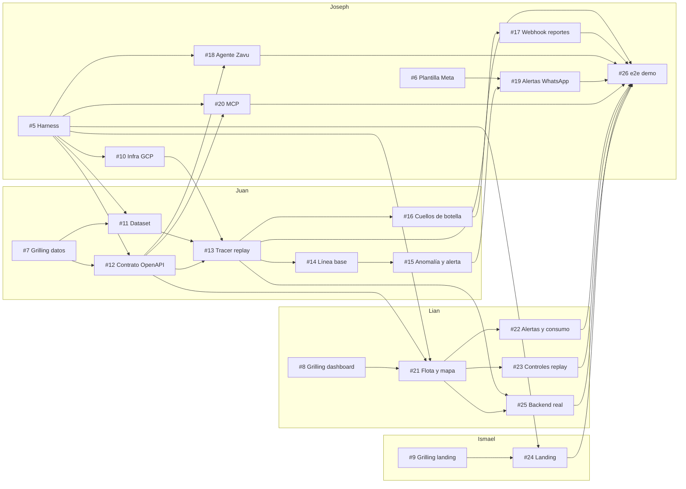

# Mapa de dependencias de issues

> **Desde el 2026-10-18 todos los tickets abiertos están asignados a Joseph**, que los implementa con el orquestador (`tools/orquestar.sh`). La columna "Dueño" indica el área original de cada ticket.

Vista general de los tickets del MVP. **La fuente de verdad es GitHub Issues**: estado, dueño y bloqueos nativos viven en cada issue. Todos son sub-issues de la spec [#4](https://github.com/npm-devs/npm-devs/issues/4).

## Cómo leer este mapa

- Un ticket está **listo para empezar** cuando todos sus bloqueos están cerrados en GitHub.
- Los tickets sin dependencias entre sí van en paralelo, cada uno en su worktree (ver [`README.md`](README.md)).
- 👤 = `ready-for-human` (requiere a una persona: consola, Meta o grilling). El resto es `ready-for-agent`.

## Tickets

| Issue | Ticket | Dueño | Bloqueado por |
|---|---|---|---|
| [#5](https://github.com/npm-devs/npm-devs/issues/5) | ~~Harness de tests y CI~~ ✅ cerrado | Joseph | — |
| [#6](https://github.com/npm-devs/npm-devs/issues/6) | 👤 Plantilla de alerta enviada a Meta y cupo de Zavu | Joseph | — |
| [#7](https://github.com/npm-devs/npm-devs/issues/7) | 👤 Grilling: datos y Domain API | Juan | — |
| [#8](https://github.com/npm-devs/npm-devs/issues/8) | 👤 Grilling: dashboard | Lian | — |
| [#9](https://github.com/npm-devs/npm-devs/issues/9) | 👤 Grilling: landing | Ismael | — |
| [#10](https://github.com/npm-devs/npm-devs/issues/10) | 👤 Infraestructura GCP con el backend desplegado | Joseph | #5 |
| [#11](https://github.com/npm-devs/npm-devs/issues/11) | Dataset de la demo reproducible y anónimo | Juan | #5, #7 |
| [#12](https://github.com/npm-devs/npm-devs/issues/12) | Contrato OpenAPI de la Domain API con datos de ejemplo | Juan | #5, #7 |
| [#13](https://github.com/npm-devs/npm-devs/issues/13) | Tracer: replay de un vehículo de punta a punta | Juan | #10, #11, #12 |
| [#14](https://github.com/npm-devs/npm-devs/issues/14) | Línea base por tramo y sentido y análisis de combustible | Juan | #13 |
| [#15](https://github.com/npm-devs/npm-devs/issues/15) | Sobreconsumo, anomalía y alerta registrada | Juan | #14 |
| [#16](https://github.com/npm-devs/npm-devs/issues/16) | Paradas, cuellos de botella y estado del viaje | Juan | #13 |
| [#17](https://github.com/npm-devs/npm-devs/issues/17) | Reportes del conductor por webhook | Joseph | #13 |
| [#18](https://github.com/npm-devs/npm-devs/issues/18) | Agente de Zavu con las tools de lectura | Joseph | #5, #12 |
| [#19](https://github.com/npm-devs/npm-devs/issues/19) | Alertas por WhatsApp | Joseph | #6, #15 |
| [#20](https://github.com/npm-devs/npm-devs/issues/20) | Servidor MCP en Cloudflare con las 7 tools | Joseph | #5, #12 |
| [#21](https://github.com/npm-devs/npm-devs/issues/21) | Dashboard: flota y mapa del replay | Lian | #5, #8, #12 |
| [#22](https://github.com/npm-devs/npm-devs/issues/22) | Dashboard: alertas y consumo por tramo | Lian | #21 |
| [#23](https://github.com/npm-devs/npm-devs/issues/23) | Dashboard: controles del replay | Lian | #21 |
| [#24](https://github.com/npm-devs/npm-devs/issues/24) | Landing nueva de Certera | Ismael | #5, #9 |
| [#25](https://github.com/npm-devs/npm-devs/issues/25) | Dashboard contra el backend real | Lian | #13, #21 |
| [#26](https://github.com/npm-devs/npm-devs/issues/26) | e2e del flujo de la demo y ensayo | Joseph | #16, #17, #18, #19, #20, #22, #23, #24, #25 |

**Frente inicial** (sin bloqueos): #5, #6, #7, #8, #9. Los cuatro devs tienen trabajo desde el minuto cero.

**Camino crítico:** #5 → #10 → #13 → #14 → #15 → #19 → #26. El harness (#5) y el contrato (#12) son los que más desbloquean.

## Grafo

