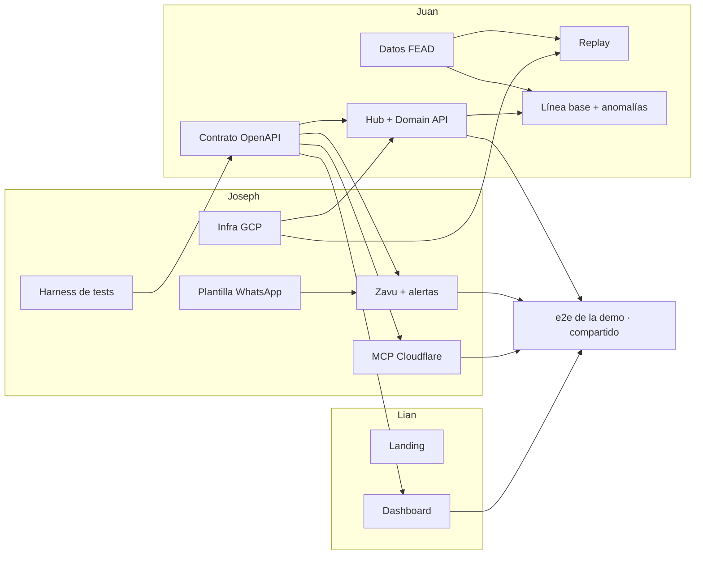

# Mapa de dependencias de issues

> **Estado: frentes definidos, tickets pendientes.** Los dueños y las dependencias entre frentes salen de las decisiones del grilling ([`validacion-producto-decisiones.md`](../research/validacion-producto-decisiones.md), D5, D19, D21 y D24). Los tickets concretos los genera `/to-tickets` en GitHub Issues; este archivo se actualiza entonces con sus números.

## Cómo leer este mapa

- Cada ticket es un issue de GitHub (`#n`) con un dueño y sus bloqueos nativos (`blocked by`).
- Un ticket está **listo para empezar** cuando todos sus bloqueos están cerrados en GitHub Issues.
- Los tickets sin dependencias entre sí pueden ir en paralelo, cada uno en su worktree (ver [`README.md`](README.md)).

## Frentes y dueños

| Frente | Dueño | Carpeta | Depende de |
|---|---|---|---|
| Harness de tests (pytest, vitest, Playwright, GitHub Actions) | Joseph | todas | — |
| Infraestructura GCP (proyecto, Cloud SQL + PostGIS, Cloud Run, Secret Manager) | Joseph | — | — |
| Plantilla de alerta de WhatsApp enviada a Meta | Joseph | — | — |
| Contrato OpenAPI de la Domain API con datos de ejemplo | Juan | `backend/` | Harness |
| Datos: descarga, extracción de 3–5 camiones, anonimización, normalización a `TelemetryEvent` | Juan | `data/` | — |
| Replay Service (asyncio dentro de FastAPI) | Juan | `backend/` | Datos, Infra |
| Hub y Domain API (esquema, consultas, correlación vehículo–viaje–evento) | Juan | `backend/` | Contrato, Infra |
| Línea base por tramo y sentido + detección de anomalías | Juan | `backend/`, `data/` | Datos, Hub |
| Zavu: webhook de reportes, agente con las tools de lectura, alertas | Joseph | `zavu/`, `backend/` (rutas de webhook) | Contrato, Plantilla |
| Servidor MCP en Cloudflare (7 tools) | Joseph | `mcp/` | Contrato |
| Web: landing nueva | Lian | `web/` | — |
| Web: dashboard (flota, alertas, mapa del replay, controles) | Lian | `web/` | Contrato |
| e2e del flujo de la demo contra la URL pública | Compartido | `e2e/` | Hub, Zavu, MCP, Web |

Fuera del MVP (D9): memoria contextual / RAG / grafo, mantenimiento predictivo y todo P1.

## Grafo de frentes

Pasa a ser el grafo de tickets cuando existan los issues.

Lo que más desbloquea es el **contrato OpenAPI**: en cuanto existe, Zavu, MCP y el dashboard avanzan en paralelo contra datos de ejemplo, sin esperar al backend real.

## Tickets

Se completa con la salida de `/to-tickets`: número de issue, título, dueño y bloqueos.
