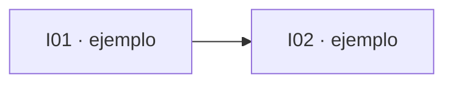

# Mapa de dependencias de issues

> **Estado: borrador.** El mapa definitivo sale de las sesiones de grilling de Joseph. Hasta entonces, los frentes de abajo vienen del backlog del documento de producto (§16) y **no son issues confirmados**.

## Cómo leer este mapa

- Cada issue tiene un ID `Ixx`, un dueño y la lista de issues de los que depende.
- Un issue está **listo para empezar** cuando todos sus bloqueos están cerrados en GitHub Issues.
- Los issues sin dependencias entre sí pueden ir en paralelo, cada uno en su worktree (ver [`README.md`](README.md)).

## Frentes provisionales (del documento de producto §16)

| Frente | Dueño tentativo | Depende de |
|---|---|---|
| Datos: perfilar FEAD EMS dataset-2, normalizador, `TelemetryProvider` | por definir | research FEAD |
| Replay Service | por definir | Datos |
| Backend/Hub: esquema, Domain API, correlación viaje-vehículo-evento | por definir | contrato `TelemetryEvent` |
| Data/ML: baseline de combustible y anomalías | por definir | Datos, Hub |
| WhatsApp (Zavu): entrada, salida y alertas | por definir | research Zavu, Hub |
| Agente + MCP tools | por definir | Domain API |
| Web: vista de flota, mapa y alertas | Lian | contratos de la Domain API |
| Research: memoria contextual (ADR) | por definir | — |

## Grafo

Se completa después del grilling.



## Issues

Se completa después del grilling. Formato por issue:

```md
### I01 · <título>
- **Dueño:** <persona>
- **Depende de:** — | I0x, I0y
- **Contrato que produce/consume:** <tipos, endpoint, tabla>
- **Hecho cuando:** <criterio verificable>
- **Rama:** feat/I01-<slug>
```
