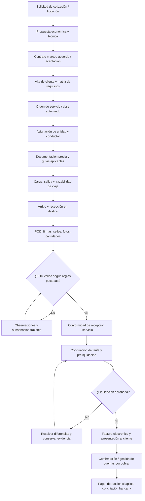
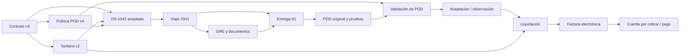

# Gestión y facturación agéntica del transporte de carga en Perú

> **Documento de investigación y diseño de producto** | Fecha: 17 de octubre de 2026  
> **Alcance:** transporte terrestre de mercancías en Perú, principalmente relaciones B2B entre generadores de carga, operadores logísticos y transportistas (incluidos subcontratistas).  
> **Objetivo:** reconstruir la cadena documental **desde la contratación hasta el cobro**, preservando la evidencia de las condiciones pactadas y la trazabilidad del *Proof of Delivery* (POD).

## 1. Resumen ejecutivo

El cuello de botella no comienza cuando el conductor intenta conseguir un sello al entregar. Puede comenzar **antes del viaje**, si las partes no dejan inequívocamente registrados la tarifa, las condiciones de entrega, los documentos exigibles, el responsable de aprobarlos, el corte de liquidación y el evento que habilita la facturación.

**Tesis de producto:** una plataforma de gestión documental y facturación agéntica debe conectar **contrato / acuerdo → orden de servicio → despacho → ejecución → entrega → POD → conformidad → liquidación → factura electrónica → cobranza**. Cada evento ha de contar con un identificador, actor, sello de tiempo, soporte probatorio y vínculo a la regla contractual aplicable.

El POD **no es automáticamente** una guía de remisión ni una factura: es el conjunto de evidencias de recepción/entrega que el cliente exige según lo contratado. Un POD puede incluir firma, sello, fotografía, cantidades recibidas, incidencias, acta y constancia digital. La GRE, por su parte, sirve para sustentar el traslado conforme a las reglas de SUNAT; la factura acredita la operación comercial a efectos tributarios. Las exigencias de papel sellado y horarios de recepción pueden ser condiciones operativas privadas y no deben confundirse con requisitos universales de SUNAT.

## 2. Actores peruanos y relaciones contractuales

| Actor | Papel en la cadena | Documentos / información que genera o confirma |
|---|---|---|
| **Generador de carga / cliente contratante** | Supermercado, distribuidor, fabricante, importador u operador logístico que encarga el traslado | Licitación, contrato marco, adendas, orden de compra (OC), orden de servicio (OS), tarifas, SLA, matriz de POD y conformidad |
| **Transportista contratado** | Empresa que acepta el servicio y responde por la ejecución pactada | Cotización, aceptación, programación, unidades/conductores, documentos de transporte según corresponda, POD y liquidación |
| **Transportista subcontratado** | Tercero que efectúa parte o todo el viaje | Suborden, aceptación, unidades, guía del transportista cuando corresponda, evidencias y comprobante por su servicio |
| **Remitente** | Sujeto responsable de la emisión de la guía de remisión remitente cuando aplique | GRE-remitente y datos de bienes, partida y llegada |
| **Destinatario / receptor** | Almacén, tienda, centro de distribución o cliente final | Registro de recepción, firma, sello, observaciones, diferencias y rechazo parcial |
| **Área de operaciones / tráfico** | Coordina la ejecución y resuelve incidentes | Hitos GPS, chats, horarios, reasignaciones, incidencias |
| **Administración / liquidación** | Conciliación entre lo pactado y lo ejecutado | Preliquidación, validación de tarifas, penalidades, extras y conformidad |
| **Facturación / cuentas por cobrar** | Emite el comprobante y gestiona el cobro | Factura electrónica, XML/CDR, constancias, vencimientos, pagos, notas de crédito/débito |

**Ejemplos de entornos peruanos para discovery, no declaraciones sobre sus procedimientos internos:** una cadena de supermercados que recibe en múltiples tiendas; un fabricante de electrodomésticos con entregas a retail; un operador logístico nacional con transportistas terceros; una flota regional pequeña que coordina por WhatsApp y Excel. Empresas como **Ransa, Dinet o Scharff** pueden ser referencias de segmentos logísticos del mercado, pero **no se ha verificado aquí** que empleen los flujos, formatos o problemas específicos descritos. Asimismo, cualquier mención a Quality Products o Chofex/Chopex debe tratarse como contexto de entrevistas hasta validación directa.

## 3. Mapa end-to-end: desde la contratación hasta el pago



### 3.1. Fase 0: prospección, RFQ y cotización

**Disparador:** el cliente solicita el traslado de bienes, una ruta recurrente o una bolsa de viajes.

**Evidencia que debe capturarse desde el inicio:**

- Solicitud o RFQ original y sus versiones; correo, portal de compras o mensaje autorizado.
- Razón social, RUC y unidad de negocio del cliente; identidad del solicitante y facultades para ordenar servicios.
- Origen, destino(s), tipos de mercancía, volumen/peso, restricciones de horario y condiciones especiales.
- Estructura de precio: por viaje, km, tonelada, parada, ruta, espera, estiba, retorno, peaje u otros conceptos.
- Vigencia de la oferta, exclusiones, impuestos, moneda, escaladores y penalidades.
- Condiciones preliminares de facturación: periodicidad, documentos exigidos, medio/canal de entrega, plazo de revisión y crédito.

**Riesgo:** una cotización aceptada informalmente sin fijar qué se cobra por esperas o entregas fallidas genera diferencias semanas después.

### 3.2. Fase 1: contratación y definición de la verdad contractual

La relación puede documentarse mediante **contrato marco + anexos**, contrato por servicio, orden de compra/orden de servicio aceptada o comunicaciones que acrediten el acuerdo, según el caso. **No debe asumirse que en todos los viajes existe un contrato escrito formal independiente**; el producto debe capturar evidencia de aceptación y escalar casos sin respaldo suficiente. La validez y fuerza probatoria concretas requieren revisión legal.

**Campos críticos del acuerdo:**

| Grupo | Datos mínimos que debería almacenar el sistema |
|---|---|
| Identidad y vigencia | Cliente, transportista, RUC, representantes, fechas, acuerdo padre, versiones y adendas |
| Servicio | Cobertura, tipos de carga, rutas, puntos de entrega, subcontratación permitida, responsabilidades |
| Precio | Tarifario versionado, extras, descuentos, penalidades, tolerancias, IGV y moneda |
| SLA | Citas, tiempos de espera, puntualidad, incidentes, pruebas de entrega aceptables |
| **POD** | Quién firma, si exige sello, número de guía, fotos, cantidades, observaciones, formato y legibilidad |
| **Presentación** | Portal, correo, oficina física, horarios de recepción, plazos y nombre del aprobador |
| **Liquidación** | Corte (semanal/quincenal/mensual), agrupación, conciliación, motivos de rechazo y SLA de respuesta |
| **Facturación y pago** | Hito que autoriza facturar, datos de OC/OS, plazo de crédito, fechas y mecanismo de pago |
| Excepciones | Entrega parcial, siniestro, reprogramación, rechazo de mercancía y cambios de tarifa |

**Regla de diseño principal:** cada orden hereda las reglas del contrato **vigentes al momento de aceptación del servicio**, no las últimas reglas editadas unilateralmente después. Una adenda posterior se registra como evento independiente con ámbito de aplicación y evidencia de aceptación.

**Output:** `contract_id`, `contract_version`, documento original inmutable, firmantes/aceptantes, `tariff_version`, `pod_policy_version`, `billing_policy_version`.

### 3.3. Fase 2: solicitud y aceptación de la orden de servicio

**Disparador:** el cliente lanza un viaje específico contra el acuerdo existente.

1. Registrar OC/OS, referencia a contrato y a tarifario vigente.
2. Vincular destino, remitente, destinatario, mercancía, ventana de carga y entrega, número de paradas y exigencias particulares.
3. Aceptación explícita por el transportista (portal, correo, sistema o evidencia autorizada).
4. Si existe diferencia frente al contrato, registrar la excepción y su aprobación; no sobrescribir el acuerdo histórico.
5. Generar `service_order_id`, `trip_id` y, si aplica, identificadores de cada parada/entrega.

**Control automático:** ninguna ejecución queda marcada como *contractualmente lista* si faltan precio, cliente pagador, criterios POD y condición que habilita facturar. Operaciones puede continuar de forma excepcional con aprobación humana y bandera de riesgo.

### 3.4. Fase 3: planificación, habilitaciones y documentación predespacho

- Asignación de placa, conductor, horarios, ruta y, si corresponde, proveedor subcontratado.
- Verificación de autorizaciones/habilitaciones aplicables, SOAT y CITV de las unidades según el caso; MTC ofrece procedimientos de autorización para transporte público de mercancías.
- Identificar **quién debe emitir** la guía de remisión remitente y la del transportista en la modalidad de traslado correspondiente.
- Emitir/recibir las guías antes del traslado, sujeto a excepciones previstas en la regulación. La GRE **sustenta el traslado**, no sustituye el contrato ni la conformidad de entrega.
- Asociar cada guía y documento al viaje y a sus destinatarios, sin asumir relación 1:1 para operaciones multiparada o consolidadas.

**Perú:** SUNAT distingue transporte privado y público (prestado por terceros), y establece guías de remitente/transportista según corresponda. La guía del transportista puede requerir una GRE-remitente previa, salvo supuestos exceptuados. No es correcto diseñar una validación universal que siempre exija ambas sin analizar la operación. [S1–S3]

### 3.5. Fase 4: carga y ejecución del viaje

**Registro de hitos:** llegada a punto de carga, inicio/fin de carga, despacho, salida, paradas, retrasos, llegada a destino y descarga.

**Fuentes prácticas:** GPS/API de terceros si existe, eventos del ERP/TMS, mensajes de WhatsApp y captura manual con identidad del emisor. GPS y WhatsApp corroboran la ejecución, **pero no son por sí mismos conformidad del cliente**.

**Capturar:** hora de evento y de recepción, coordenadas cuando haya consentimiento y justificación, foto/documento, autor, fuente, integridad, incidencia y referencia a OS/guía.

### 3.6. Fase 5: entrega y construcción del POD

**POD (Proof of Delivery)** es un *expediente de evidencias*, no un único PDF obligatorio en todos los clientes.

| Elemento | Valor probatorio / validación | Fuente típica |
|---|---|---|
| Guía vinculada | Identifica mercancía y traslado; no prueba por sí sola recepción conforme | GRE/documento de traslado |
| Firma / identificación del receptor | Acredita recepción según política del cliente | Papel fotografiado o ePOD |
| Sello requerido | Evidencia adicional **si fue pactada** | Hoja física escaneada/fotografiada |
| Fecha/hora/lugar | Contexto de entrega y ventana SLA | Aplicación, evento GPS, documento |
| Cantidad recibida vs. despachada | Detecta faltantes, sobrantes y devoluciones | Registro de recepción/acta |
| Fotos de descarga o bultos | Soporte de estado/condición, sujeto a privacidad | Móvil del conductor |
| Incidencia / reserva | Distingue entrega sin observaciones de recepción parcial o dañada | Acta, chat, conformidad |
| Identidad y versiones | Permite probar qué orden/regla aplicó | Sistema documental |

**Estados sugeridos:** `pendiente_de_entrega → evidencia_recibida → validacion_automatica → requiere_subsanacion | apto_para_revision → presentado_al_cliente → observado | aceptado`.

**Regla clave:** nunca generar sellos, firmas, fechas de recepción o conformidades que no existieron. La IA puede normalizar el aspecto del expediente, extraer datos y señalar faltantes, pero no fabricar evidencia ni modificar el contenido original. Ante exigencia física, coordinar captura/entrega física; generar un PDF no satisface por sí mismo una obligación de presentar un original sellado.

### 3.7. Fase 6: validación y aceptación documental

- Recuperar la **versión aplicable** de la matriz de POD y del acuerdo del cliente.
- Comparar documentos aportados con los requeridos por cliente, centro de recepción, tipo de carga y orden.
- Verificar OCR/multimodal con niveles de confianza; requerir revisión humana para campos críticos.
- Comprobar referencias cruzadas: cliente, OC/OS, número de guía, placa, destino, fecha, cantidad, receptor, servicio.
- Validar formatos y canal de presentación; documentar rechazo y causa concreta.
- Registrar **fecha de presentación** y **fecha de aceptación** diferenciadas, además de la identidad del aprobador.

**Distinguir tres hitos:** (a) entrega física de la mercancía, (b) aceptación del expediente POD y/o conformidad comercial del servicio y (c) conformidad o disconformidad de la factura electrónica para fines de factura negociable. **No son lo mismo**, ni necesariamente ocurren juntos. [S6]

### 3.8. Fase 7: liquidación y conciliación

La liquidación convierte servicios ejecutados en importes reclamables según el acuerdo.

```text
Importe preliminar = tarifa base pactada
                    + extras aprobados y documentados
                    - descuentos/penalidades sustentados
                    ± ajustes autorizados
```

Conciliar, por línea: `contrato y versión ↔ OS ↔ viaje ↔ entrega/POD ↔ tarifario ↔ extras ↔ conformidad`. Incluir evidencia de cálculo para tiempos de espera, descarga adicional, devolución, viaje fallido, peajes y diferencias de tonelaje si aplica.

**No confundir:** liquidación comercial al cliente, liquidación al subcontratista y pago al conductor son flujos distintos, con reglas y contrapartes separadas.

### 3.9. Fase 8: facturación electrónica

- Una vez alcanzado el hito contractual adecuado y con revisión humana donde aplique, crear borrador de factura por el servicio del transportista (no por el valor de la mercancía).
- Incorporar OC/OS, liquidación, referencias y fechas según las necesidades del cliente y del sistema de emisión.
- Emitir por sistema autorizado y conservar XML, estado de aceptación tributaria, CDR cuando aplique y representación PDF.
- Si es venta **al crédito**, capturar importe neto pendiente, fechas de vencimiento y cuotas conforme a los requisitos de SUNAT. [S5]
- Para transporte terrestre de bienes gravado con IGV, analizar la **detracción SPOT**, cuando corresponda; SUNAT identifica el umbral de S/ 400 para el importe de la operación o valor referencial, según el caso. Subcontrataciones también pueden estar comprendidas. **El porcentaje, valor referencial y demás condiciones deben determinarse por operación con normativa vigente**. [S4]

**Control:** el agente no debe emitir comprobantes unilateralmente ni elegir tratamientos tributarios inciertos; integrar a facturación y solicitar aprobación humana.

### 3.10. Fase 9: cobranza, factoring y cierre

- Registrar fecha de emisión, presentación al cliente, conformidad, vencimiento pactado, abonos, detracciones y saldo.
- Detectar facturas vencidas y razones de impago (rechazo documental, disconformidad comercial, error de tarifa, cronograma interno, otra).
- Mostrar días desde entrega a POD, desde POD a aprobación, desde aprobación a factura y desde factura a cobro.
- Como opción **posterior** y no centro del MVP, preparar documentación para factoring/Factura Negociable. La SUNAT dispone una plataforma específica para conformidad de facturas electrónicas al crédito vinculada a la negociación en CAVALI. [S6]
- No prometer liquidez inmediata: aprobación documental más rápida puede adelantar la facturación, pero no altera automáticamente los días de crédito, la conducta de pago ni la aceptación de una entidad de factoring.

## 4. Cadena de trazabilidad documental propuesta

**Unidad fundamental:** no tratar el POD como archivo suelto. Cada artefacto lleva procedencia y enlaces hacia atrás.



### Modelo lógico mínimo

| Entidad | Identificador y vínculos esenciales |
|---|---|
| `Customer` / `TransportCompany` | `party_id`, RUC, razón social, roles |
| `Contract` / `ContractVersion` | `contract_id`, `version_id`, fechas, archivo original, hash, aceptación, adendas |
| `TariffPolicy` | `tariff_version_id`, vigencia, rutas, reglas de extras y penalidades |
| `PODPolicy` | `pod_policy_version_id`, cliente/sede, criterios y canal de aceptación |
| `ServiceOrder` | `order_id`, OC/OS externa, `contract_version_id`, `tariff_version_id`, `pod_policy_version_id`, aceptación |
| `Trip` / `Stop` | `trip_id`, `stop_id`, unidad, conductor, subcontratista, destino, horarios |
| `ShipmentDocument` | Tipo GRE/documento, serie-número, emisor, archivo/XML, vínculo a carga/viaje |
| `Event` | `event_id`, fecha del hecho, fecha de captura, actor, fuente, localización si legítima |
| `Evidence` | `evidence_id`, tipo, original inmutable, SHA-256, metadatos, vínculo con entrega y orden |
| `PODCase` / `PODReview` | `pod_case_id`, política, validaciones, observaciones, versiones y aprobador |
| `Settlement` | `settlement_id`, líneas referenciadas a viajes, cálculo, aprobación |
| `Invoice` | Serie, correlativo, XML/CDR/estado y vínculo a liquidación |
| `Receivable` / `Payment` | Vencimiento, importe, detracción, abonos y conciliación |

### Reglas de auditabilidad

1. **Inmutabilidad del original:** conservar PDF, XML, foto o mensaje original; publicar correcciones como nuevas versiones.
2. **Evidencia de acuerdo:** mantener tanto cláusula/regla pactada como aceptación concreta de la OS.
3. **Doble tiempo:** `event_occurred_at` vs. `recorded_at`; no confundir cuándo ocurrió una entrega con cuándo se subió una foto.
4. **Proveniencia:** origen correo/WhatsApp/API/usuario y permisos adecuados; diferenciar dato extraído de dato validado.
5. **Explicabilidad:** toda decisión de un agente debe indicar evidencias citadas, regla aplicada y confianza.
6. **Segregación:** las notas e inferencias del LLM no sustituyen hechos o aceptaciones de terceros.
7. **Seguridad:** controles por empresa/RUC, acceso mínimo, cifrado, política de retención y tratamiento de datos personales conforme a la regulación aplicable.
8. **Integridad:** hashes y registros de auditoría ayudan a detectar alteraciones, pero no prueban por sí solos identidad, consentimiento o validez legal.

## 5. Reglas peruanas que condicionan el producto

| Tema | Implicación para el flujo | Precaución |
|---|---|---|
| Autorización de transportistas | Capturar datos de habilitación, vehículos y documentos MTC según modalidad | Aplicabilidad por modalidad, carga y servicio; verificar versión vigente [S7] |
| Guía de remisión | Evidenciar traslado e identificar remitente/transportista/destinatario | No confundir con POD; excepciones de emisión [S1–S3] |
| Factura electrónica | Integrar emisor electrónico y estados válidos de comprobante | PDF aislado ≠ emisión válida; consultar requisitos SUNAT [S5] |
| Detracciones | Configurar operaciones SPOT y soportes de depósitos | No aplicar tasa/umbral sin evaluar operación y valores referenciales [S4] |
| Factura negociable | Oportunidad futura para preparar expediente financiero | Conformidad tributaria/financiera distinta de aceptación POD [S6] |
| Condiciones contractuales privadas | Registrar formatos de cliente, cargos, horarios y plazos | No tratarlas como norma general; documentar su fuente contractual |

**Nota de alcance:** este documento presenta una arquitectura operativa, no asesoría legal o tributaria. Para cada integración productiva se necesita revisión especializada de normas, régimen del transportista, cargas reguladas, privacidad, conservación de documentación y facultades de firma.

## 6. Casos peruanos representativos (hipotéticos, para discovery)

### Caso A: proveedor de retail → transportista → centro de distribución

1. El retail u operador emite OS de 10 entregas, tarifa por ruta, corte quincenal y matriz POD por sede.
2. El transportista acepta y asigna unidad; se vinculan GRE y datos de carga.
3. Se reciben 9 entregas sin observación; una presenta faltante anotado por almacén.
4. El agente arma expedientes separados por entrega, identifica la discrepancia y evita declarar conforme la entrega incompleta.
5. Liquidación distingue 9 líneas sin incidencias y 1 en revisión, según si el contrato permite facturación parcial.
6. Facturación emite lo autorizado, conservando la secuencia documental.

**Validación crítica:** ¿la aceptación del POD es por tienda, por guía, por OS, por viaje o por lote quincenal?

### Caso B: fabricante de electrodomésticos → operador logístico → transportista tercero

Existe una cadena doble de contratación: **fabricante–operador** y **operador–transportista**. Las tarifas y SLA pueden diferir. La plataforma debe preservar ambos acuerdos y no compartir el precio comercial del operador con el transportista si no corresponde. El POD del destinatario sirve como evidencia operativa compartida, pero la conformidad y liquidación se evalúan **por relación contractual**.

### Caso C: microtransportista con WhatsApp y papel

El transportista acepta OS por mensaje autorizado, recibe datos de carga y transporta con guías aplicables. El conductor envía foto de la recepción firmada. El sistema extrae campos y pide reenvío si el sello o número requerido no es legible. Administración valida el expediente y lo presenta por canal pactado, sin obligar al conductor a dominar un ERP complejo.

## 7. Diseño del sistema agéntico

| Agente/componente | Responsabilidad | Límites |
|---|---|---|
| **Agreement Ingestion** | Extraer términos del contrato, OC, OS, correo y anexos; proponer matriz de reglas | Una persona valida aceptación, ambigüedades y vigencia |
| **Dispatch & Evidence** | Vincular viaje, guías, GPS y eventos; solicitar evidencias faltantes | No inventar datos de ubicación o recepción |
| **POD Validation** | Comparar documentos contra política contractual, detectar omisiones y diferencias | No falsificar sellos, firmas, aprobaciones |
| **Exception Resolution** | Clasificar rechazos, redactar requerimientos y rearmar expediente | Escalar cambios contractuales o disputas |
| **Settlement** | Conciliar OS, viajes, tarifas, esperas y extras documentados | Tarifas y reglas deterministas; humanos aprueban excepciones |
| **Billing Readiness** | Preparar paquete listo para facturar e integrarlo con ERP | No emitir ni declarar tratamiento tributario incierto autónomamente |
| **Collections** | Seguimiento de recepción de factura, vencimientos y pagos | No afirmar pagos sin conciliación verificable |

**Arquitectura recomendada:** LLM para lectura de documentos no estructurados, búsqueda de cláusulas y orquestación; **motor de reglas determinista** para tarifas, plazos, importes, controles fiscales y estados; almacenamiento de originales y auditoría de eventos. Los agentes proponen y gestionan excepciones, pero no deben transformar una inferencia en evidencia.

## 8. MVP: desde el contrato hasta el POD y la preliquidación

**Hipótesis:** prevalidar el expediente de entrega con reglas heredadas de un acuerdo comercial reducirá rechazos y días de preparación de la liquidación.

**Happy path demostrable (end-to-end):**

1. Subir un **contrato marco ficticio** y un anexo que exija, por ejemplo, firma, sello y número de OS para la sede A.
2. El sistema extrae y muestra tarifas/reglas con fuente y solicita aprobación humana.
3. Crear una orden de servicio vinculada al contrato y simular su aceptación.
4. Registrar un viaje con guía de muestra, hitos y entrega.
5. Subir un POD incompleto (falta número de OS o no se visualiza un sello pactado).
6. Agente identifica el incumplimiento, muestra la cláusula aplicable y pide subsanación real.
7. Subir evidencia corregida auténtica; generar expediente con documentos originales, índice y trazabilidad.
8. Generar preliquidación por tarifa acordada y marcar `listo_para_facturar`, sin emitir factura real.
9. En dashboard, mostrar tiempos, rechazo evitado y monto desbloqueado **para preparación de factura**, no dinero cobrado.

**Fuera de alcance inicial:** emisión SUNAT en producción, factoring automatizado, cálculo fiscal totalmente autónomo, instalación de hardware OBD, telemetría propia y cobro bancario.

### Demos de excepción valiosas

- El cliente cambia formato tras la orden: mostrar diferencia entre política contractual aplicable y nueva solicitud, y requerir aceptación de adenda cuando corresponda.
- Entrega parcial: segregar cantidades recibidas y no inventar aceptación total.
- Dos relaciones contractuales (operador y subtransportista): evitar mezclar tarifas y cuentas por cobrar.
- Servicio completado sin sello: no generar sello; solicitar evidencia alternativa **solo si el cliente la acepta**.

## 9. KPIs y criterios de éxito

| KPI | Definición sugerida | Cómo medir |
|---|---|---|
| `POD first-pass acceptance` | POD aceptados al primer envío / POD enviados | Estado final por versión y cliente |
| `Delivery-to-POD-ready` | Tiempo desde recepción física hasta expediente completo | Timestamps auditables |
| `POD-to-approval` | Tiempo entre primer envío y aceptación documental | Eventos de presentación y revisión |
| `Delivery-to-invoice` | Tiempo desde entrega hasta emisión de factura | Hitos de entrega y factura |
| `Rework rate` | Expedientes con ≥1 subsanación / expedientes presentados | Eventos de observación |
| `Unbilled delivered value` | Valor acordado de entregas aún no facturadas | OS + tarifas + conciliación |
| `DSO` | Días de cuentas por cobrar a cobro, según definición financiera utilizada | Facturas, vencimientos y pagos |

**No tratar estimaciones de entrevistas como datos de mercado confirmados:** cobros a 90 días, repartición de camiones tecnificados, porcentaje de rechazos o ahorro de días requieren medición por cliente y segmento.

## 10. Customer discovery: preguntas por actor

**A compras / cliente contratante**

1. ¿Usan contrato marco, OC, OS o una combinación? ¿Qué documento prevalece si hay contradicción?
2. ¿Quién tiene autoridad para modificar el tarifario o cambiar el formato de POD?
3. ¿Qué evento permite emitir una factura y qué evidencia deben recibir antes?
4. ¿Se acepta firma digital/foto/PDF o exigen papel original con sello? ¿En qué centros y por qué?
5. ¿Qué porcentaje de POD se rechaza al primer intento y por cuáles motivos?

**A operaciones del transportista**

6. ¿Cómo vinculan cada viaje con el contrato y la tarifa realmente aceptados?
7. ¿Dónde guardan las GRE, chats, fotos y recepciones? ¿Cómo buscan un viaje de hace tres meses?
8. ¿Cómo se registran esperas, devoluciones, rutas extra y entregas parciales?
9. Si subcontratan, ¿cómo obtienen y verifican la evidencia del tercero?

**A liquidación, facturación y cuentas por cobrar**

10. ¿Cómo agrupan viajes por quincena o mes? ¿Quién da la conformidad de cada línea?
11. ¿Qué errores frenan la liquidación aunque la entrega ya haya ocurrido?
12. ¿Cuántos días hay entre entrega, POD completo, aprobación, factura y pago real?
13. ¿Cuál es la principal causa de discrepancia: tarifas, fechas, faltantes, guías, sellos o OC?
14. ¿El plazo de pago se cuenta desde la factura, presentación en portal o aprobación de expediente?
15. ¿Qué ERP, sistema de facturación, correo, WhatsApp o portal recibe los documentos?

## 11. Prioridades de validación (sin inventar resultados)

| Prioridad | Incertidumbre | Evidencia requerida |
|---|---|---|
| P0 | Documento que realmente origina una obligación de transporte | 5 ejemplos anonimizados de contrato + OS + aceptación |
| P0 | Motivo real de rechazo de POD | 20 expedientes anonimizados aprobados/rechazados |
| P0 | Hito exacto que habilita factura | Procedimiento de cuentas por pagar / cláusula por cliente |
| P0 | Tiempo y costo de reproceso | Logs de entregas, presentaciones y aprobaciones |
| P1 | Complejidad de subcontratación | Un flujo operador → transportista tercero |
| P1 | Integrabilidad | APIs o exportaciones ERP/TMS/GRE y permisos de acceso |
| P2 | Telemática | Disponibilidad real de GPS y datos de proveedor |
| P2 | Factoring | Volumen y elegibilidad de cuentas por cobrar |

## 12. Recomendación de posicionamiento

**Categoría:** *Agentic Freight Documentation & Billing Operations*.

**Problema:** servicios de transporte ejecutados quedan detenidos antes de facturar debido a requisitos documentarios fragmentados, interpretaciones manuales y conciliaciones lentas.

**Propuesta de valor:** **«Desde el contrato hasta la factura: cada entrega respaldada, cada regla validada, cada liquidación trazable».**

**Diferenciador:** no se limita a escanear un POD. Recupera la obligación contractual que originó la orden, verifica evidencias de ejecución, identifica qué exige cada cliente y construye un expediente explicable para aprobación y preliquidación.

---

## 13. Fuentes oficiales y referencias para verificación

Las siguientes fuentes sustentan el marco regulatorio general; **no validan por sí solas prácticas contractuales de empresas específicas**.

- **[S1] SUNAT — Guías de remisión: definición y modalidades.** https://orientacion.sunat.gob.pe/01-definicion-y-aspectos-generales
- **[S2] SUNAT — Guía de remisión electrónica (GRE).** https://cpe.sunat.gob.pe/tipos_de_comprobantes/guiaderemision
- **[S3] SUNAT — Guía de remisión transportista.** https://orientacion.sunat.gob.pe/03-guia-de-remision-transportista
- **[S4] SUNAT — SPOT/detracciones en transporte terrestre de bienes.** https://orientacion.sunat.gob.pe/detracciones-en-el-transporte-de-bienes-por-via-terrestre
- **[S5] SUNAT — Preguntas frecuentes de comprobantes electrónicos, forma de pago contado/crédito.** https://cpe.sunat.gob.pe/informacion_general/preguntas_frecuentes
- **[S6] SUNAT — Plataforma de conformidad de factura electrónica y factoring.** https://cpe.sunat.gob.pe/plataforma-de-confirmacion-del-rhe-y-de-la-fe
- **[S7] MTC — Autorización para prestar servicio de transporte público de mercancías.** https://www.gob.pe/institucion/mtc/pages/13429-solicitar-autorizacion-para-prestar-servicio-de-transporte-publico-de-mercancias
- **[S8] SUNAT — Tipos de comprobante electrónico.** https://cpe.sunat.gob.pe/informacion_general/tipos_comprobantes_pago

**Fuentes primarias aún necesarias:** entrevistas, contratos reales anonimizados, órdenes de servicio, matrices POD, ejemplos de expedientes observados, procedimientos de recepción documental y reportes de cobranza de empresas del segmento objetivo.
