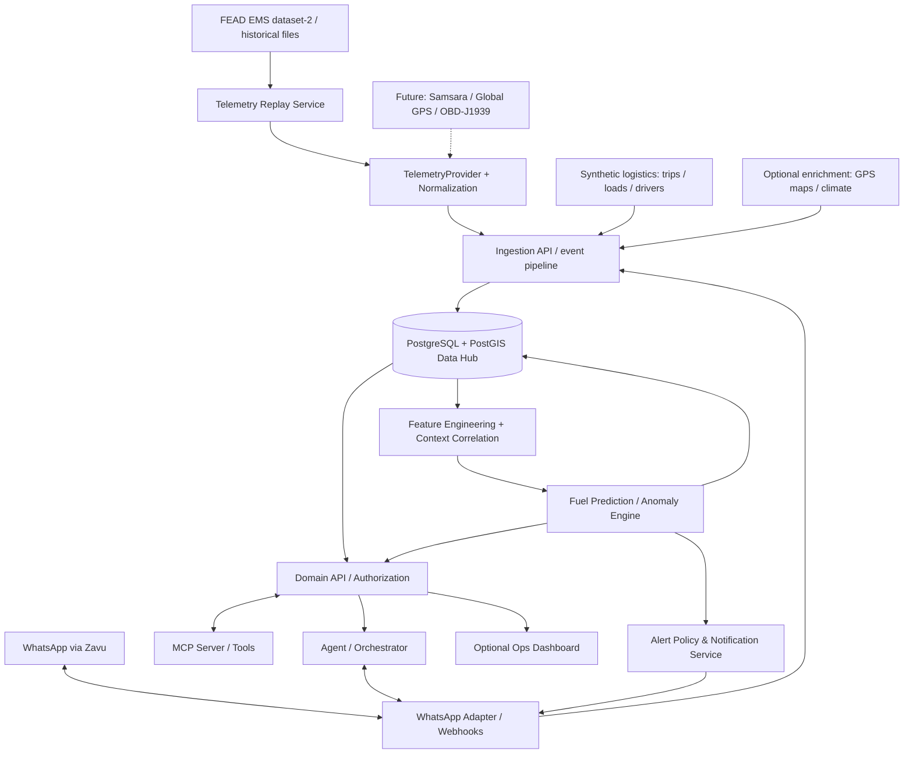

# Certera — Product Context & Technical Handoff

> **Estado:** Documento de contexto inicial para equipo de desarrollo (18 de octubre de 2026).  
> **Objetivo:** Alinear problemática, visión, alcance del MVP, flujos, fuentes de datos, arquitectura propuesta y decisiones abiertas.  
> **Nombre del producto:** Certera (antes se usaba *Fleet Intelligence* como placeholder; ver D38).

## 1. Resumen ejecutivo

Queremos construir una **plataforma de inteligencia operacional predictiva para el transporte de mercancías** (fletes de alimentos perecibles, carga industrial, minería y otras categorías). El sistema unifica **telemetría vehicular, GPS, condiciones de ruta/ambiente y reportes humanos por WhatsApp** para explicar lo que ocurre en cada viaje, anticipar sobreconsumo de combustible y facilitar decisiones operativas.

**Fuente de telemetría del MVP:** **FEAD (EMS dataset-2)**, datos históricos reales reproducidos por un **Telemetry Replay Service**. No es una transmisión en vivo: la reproducción simula la llegada progresiva de eventos. Los fletes, contratos, conductores y otros detalles operativos necesarios para la demo podrán ser **sintéticos y estarán marcados como tales**. Samsara/Global GPS Perú/gateways OBD-II/J1939 quedan como integraciones futuras, no bloqueantes.

**Enfoque principal del MVP:** estimar y detectar **consumo anómalo de combustible** en camiones/fletes, atribuyendo posibles causas a condiciones de operación y contexto. **Extensión deseable, si alcanza el tiempo:** señales de **mantenimiento predictivo**. No queremos restringir el producto a carga pesada: debe poder adaptarse a distintos tipos de vehículos, cargas y operaciones.

El gestor de flota podrá **recibir alertas en WhatsApp** y **consultar por WhatsApp** el estado de sus camiones/fletes, el consumo estimado, las anomalías o los cuellos de botella. Además, expondremos herramientas de consulta para agentes de IA mediante un **servidor MCP (Model Context Protocol)** —interpretación de la mención a “MVP server”; confirmar con el equipo si se refería a MCP— conectado al hub de datos y a los servicios de predicción. El dashboard web es una interfaz complementaria deseable, no un sustituto del canal WhatsApp.

## 2. Problemática

Los operadores de transporte suelen tener información **fragmentada** entre sensores del vehículo, GPS, proveedores de telemetría, conductores, mensajes y sistemas empresariales. Esto dificulta:

- Conocer en contexto qué sucede con un camión y con el **flete/viaje** que realiza.
- Distinguir entre consumo esperable y **sobreconsumo** por ralentí, pendiente, altitud, carga, estilo de conducción, desvíos u otras condiciones.
- Explicar por qué un vehículo está detenido (descanso, baño, incidente, carga/descarga, congestión, falla mecánica).
- Detectar cuellos de botella y riesgos a tiempo, antes de que incrementen el costo del viaje o afecten las entregas.
- Consultar la información de forma natural, sin navegar varias plataformas.

**Enunciado corto:** Falta una visión contextualizada y predictiva de la operación de fletes para identificar sobreconsumo, anomalías y riesgos antes de que generen pérdidas.

## 3. Solución y diferenciador

Un **hub de inteligencia operacional** que:

1. Ingiere inicialmente telemetría histórica **FEAD / EMS dataset-2**, mediante un **Telemetry Replay Service** que la emite como eventos secuenciales. La interfaz `TelemetryProvider` permitirá integrar después **Samsara**, **Global GPS Perú** o gateways **OBD-II/J1939**, sin reescribir la lógica del producto.
2. Asocia cada lectura con el **vehículo, el viaje/flete, el conductor, la carga y la ubicación**, conservando marca de tiempo y fuente.
3. Incorpora contexto geoespacial y ambiental: **latitud, longitud, altitud, pendientes, temperatura** y, cuando esté disponible, clima, estado vial y peso de carga.
4. Recibe reportes humanos de conductores u operadores vía **WhatsApp**, mediante la integración prevista con **Zavu**; los vincula temporal y operacionalmente con un viaje.
5. Analiza desviaciones de combustible, estima el consumo esperado y presenta **posibles factores explicativos**, con nivel de confianza.
6. Emite **alertas proactivas en WhatsApp** y responde **consultas en lenguaje natural**.
7. Ofrece acceso controlado mediante herramientas de un **servidor MCP**, para que agentes autorizados consulten estado y soliciten predicciones.

**Diferenciador:** no analizar la telemetría aisladamente, sino **cruzarla con explicaciones humanas y contexto del viaje**, minimizando falsas conclusiones (ej.: “vehículo detenido por falla” versus “parada programada para ir al baño”).

## 4. Usuarios y escenarios

- **Gestor de flota / coordinador de operaciones:** visualiza todos los vehículos, recibe alertas, prioriza acciones y consulta cuellos de botella.
- **Despachador / gestor de fletes:** rastrea cada traslado, su estado, ruta, ETA opcional y desviaciones de costo.
- **Conductor:** reporta eventos y razones de detención por WhatsApp; opcionalmente recibe solicitudes breves de aclaración.
- **Analista de operaciones / mantenimiento:** revisa patrones y posibles problemas mecánicos.

**Aclaración del modelo de negocio:** un **vehículo** puede ejecutar varios **fletes/viajes** en momentos distintos. El estado del camión no equivale automáticamente al estado de una entrega. Debemos modelar ambas entidades por separado.

## 5. Alcance

### P0 — MVP funcional (imprescindible)

- Registro o importación de vehículos y fletes/viajes, con relación vehículo ↔ viaje y una forma simple de identificar conductor y estado.
- Ingesta demostrable desde **FEAD EMS dataset-2** (registros históricos reales), con adaptador normalizador y **replay configurable** (pausar/reanudar, velocidad de reproducción, camión y rango). No se requiere Samsara ni hardware en el MVP.
- Registro de GPS y al menos un indicador utilizable de combustible (consumo acumulado, porcentaje de tanque o litros calculados con limitaciones explícitas).
- Hub con histórico de eventos y consultas por vehículo, flete y periodo.
- Ingesta de mensajes/reportes WhatsApp por Zavu, asociándolos al viaje y al tiempo correctos.
- Motor inicial para estimar consumo esperado / detectar anomalías; puede ser una **línea base estadística o reglas** antes de ML sofisticado.
- Flujo completo de **alerta WhatsApp** por anomalía y **consulta WhatsApp** de estado/consumo/posible cuello de botella, con evidencia y hora de última actualización.
- API de negocio y **servidor MCP** con al menos una herramienta read-only que acceda al hub **a través de una capa de servicios**; idealmente otra de predicción.
- Trazabilidad: cada respuesta/predicción indica vehículos, rango de tiempo, datos usados, grado de certeza y si la telemetría es **FEAD real reproducida** o el contexto logístico es **sintético**.
- Modelo de proveedor desacoplado (`TelemetryProvider`) y eventos normalizados con `event_time` vs `ingested_at` / `replayed_at`.

### P1 — Si hay tiempo

- Predicción de fallas/mantenimiento basada en códigos de falla, temperaturas, RPM, horas de motor, historial y patrones anómalos.
- Alertas de riesgo mecánico y sugerencias de inspección (sin afirmar diagnósticos definitivos).
- Dashboard con mapa, tendencias y explicaciones visuales.
- Predicción de retrasos/ETA y correlación con consumo.

### Fuera de alcance inicial

- Optimización completa de rutas, pricing automático de fletes, motor de gestión ERP y automatizaciones críticas de seguridad del vehículo.
- Diagnósticos mecánicos concluyentes sin suficiente evidencia o históricos.
- Cobertura garantizada de cualquier sensor, marca de camión o modelo de motor.

## 6. Fuentes de datos y estrategia FEAD-first

### 6.1 Fuente elegida para el MVP: FEAD

**FEAD — Fuel Rate Prediction for Heavy-Duty Trucks** ([repositorio de investigación](https://github.com/Torreskai0722/FEAD)) recoge datos de sensores del **Engine Management System (EMS)** y de un **Instant Fuel Meter (IFM)**. La tabla pública del repositorio describe **EMS dataset-2** con **29 camiones**, **26 145 539 registros** (abril de 2020), variables del motor y campos como latitud, longitud, tiempo de activación, ciudad y clasificación de carretera. La descripción general incluye velocidad del motor/RPM, torque, acelerador y tasa de combustible, con adquisición de estado del motor cada ~100 ms; esto **no garantiza que todas las señales estén presentes o a esa frecuencia en cada archivo/fila**.

**Archivos a utilizar:** principalmente **EMS dataset-2**. El IFM es una fuente distinta y no debe asumirse que sus filas puedan unirse vehículo-a-vehículo a EMS dataset-2 sin identificadores y tiempos compatibles. Antes de implementar el modelo predictivo, inspeccionar archivos reales, licencia/términos, valores faltantes, estructura, cardinalidad de camiones, rangos temporales, IDs, coordenadas, unidades, resolución de muestras y definición exacta de **fuel rate**/variable objetivo.

> **Procedencia:** telemetría histórica observada en vehículos reales, **no telemetría en tiempo real**, **no vehículos peruanos demostrados**, **no fletes reales vinculados**. Durante la reproducción la hora del evento original debe permanecer intacta y separada de la hora de emisión simulada.

| Fuente | Disponibilidad en el MVP | Datos y cautelas |
|---|---|---|
| **FEAD / EMS dataset-2** | **P0: fuente inicial** | Motor, combustible y GPS según columnas efectivamente verificadas; datos históricos replayados, no una API live. |
| **Logística sintética** | **P0: demo** | Vehículos de demo, asignaciones a fletes/viajes, estado de entrega, conductores, carga, paradas y reportes humanos de escenario. Nunca presentarlos como hechos históricos de FEAD. |
| **WhatsApp vía Zavu** | **P0: canal bidireccional** | Mensajes de conductores/operadores y notificaciones; validar proveedor, webhooks, autenticación y plantillas. Durante demo se asociarán a viajes sintéticos y datos replayados. |
| **GPS / cartografía / clima / elevación** | **Opcional según disponibilidad** | Coordenadas en FEAD; altitud, temperatura y clima **no se presuponen presentes**. Incorporar fuente externa o no modelarlos; evitar inventar datos ambientales. |
| **Samsara API** | **Integración futura** | Proveedor comercial sustituible vía `TelemetryProvider`, dependiente de credenciales/organización y permisos. |
| **Global GPS Perú / gateway OBD-II/J1939** | **Integración futura** | Conectores y hardware a investigar, sin bloqueo para el MVP. “BDP” se conserva como nombre por aclarar, no como protocolo confirmado. |

**Consideraciones físicas:** altitud, pendiente, temperatura, carga y comportamiento de conducción pueden cambiar consumo/rendimiento, pero sin columnas verificadas o enriquecimiento fiable no deben figurar como features efectivamente disponibles. No inferir causalidad por una simple correlación.

### 6.2 Telemetry Replay Service

Servicio independiente y configurable para **simular el streaming** de registros históricos:

1. Descargar/obtener los archivos de EMS dataset-2 y registrar origen, checksum y versión.
2. Perfilar y validar columnas/unidades; normalizar cada fila al contrato de `TelemetryEvent` (más abajo), conservando el payload crudo o su referencia.
3. Ordenar por `vehicle_id` y timestamp **de evento**, manejando duplicados y huecos; asociar los IDs FEAD a alias de demo sin confundirlos con placas reales.
4. Seleccionar camión, segmento y velocidad de replay (`1x`, `10x`, etc.), con pause/resume y reinicio reproducible. Evitar dormir un intervalo por cada fila de 100 ms cuando el volumen lo impida: batching/backpressure.
5. Publicar eventos normalizados al backend a través de interfaz de transporte desacoplada (HTTP/event bus, decisión de implementación pendiente), con idempotencia y monitoreo.
6. Persistir en **PostgreSQL + PostGIS** para relaciones, eventos y consultas geoespaciales; usar bulk ingest/particionado e índices para evitar cargar los 26 M registros en memoria o en la BD sin necesidad.
7. Separar **`event_time`** (fecha original), **`replayed_at`** (hora de reproducción) y **`ingested_at`** (recepción); indicar el modo **`historical_replay`** en API, alertas y UI.

Contrato de integración ilustrativo (sujeto a mapeo real de FEAD):

```typescript
interface TelemetryEvent {
  event_id: string;
  vehicle_id: string;                 // ID normalizado; mapeado desde FEAD
  event_time: string;                 // UTC del registro histórico
  replayed_at?: string;               // hora de emisión simulada
  ingested_at: string;                // hora de entrada al backend
  provider: 'fead' | 'samsara' | 'global_gps' | 'vehicle_gateway';
  mode: 'historical_replay' | 'live';
  latitude?: number;
  longitude?: number;
  signals: Record<string, { value: number; unit: string }>;
  raw_record_ref?: string;
}

interface TelemetryProvider {
  start(options: { vehicleIds?: string[]; speed?: number; from?: string; to?: string }): Promise<void>;
  stop(): Promise<void>;
  // Transmite eventos normalizados a través de un callback o stream acordado.
}
```

La interfaz anterior define una **intención de diseño**, no un SDK ya implementado; conectar proveedores futuros mediante adaptadores sin modificar correlación, predicción, MCP ni WhatsApp.

**Fuentes:** [README FEAD](https://github.com/Torreskai0722/FEAD), [artículo de investigación citado por sus autores](https://www.weisongshi.org/papers/liu23-fuel.pdf) (comprobar disponibilidad). La licencia de reutilización/distribución debe revisarse antes de empaquetar los datos.

## 7. Modelo lógico mínimo de datos (hipótesis, no diseño definitivo)

Entidades sugeridas:

- `vehicle`: id, placa/alias, tipo, marca/modelo, tipo de motor, capacidad de tanque opcional.
- `driver`: id, identificador interno, canal WhatsApp autorizado.
- `shipment` / `freight`: id, tipo de mercancía, peso aproximado opcional, origen, destino, cliente, estado.
- `trip`: id, `vehicle_id`, `shipment_id`, `driver_id`, inicio/fin, ruta planeada, estado.
- `telemetry_reading`: `vehicle_id`, `event_time`, `replayed_at`, `ingested_at`, tipo de señal, valor, unidad, `provider`, `mode`, calidad y referencia al archivo original.
- `position_reading`: `vehicle_id`, `event_time`, lat, lon, altitud/velocidad **solo si disponibles**, precisión si se conoce, y geometría PostGIS.
- `human_report`: `trip_id`, emisor, timestamp del evento y recepción, texto original, categoría, confianza, `provenance` (`synthetic_demo` o `actual_whatsapp`).
- `operational_event`: parada, desvío, ralentí, carga/descarga, falla reportada; evidencia y estado.
- `prediction`: vehículo/viaje, ventana temporal, target, valor estimado, intervalo o confianza, versión del modelo.
- `alert`: tipo, severidad, destinatario, evidencia, estado, timestamp de envío y de confirmación.

**Separación indispensable:** `vehicle_source_map` (IDs FEAD ↔ alias del camión de demo), `trip_vehicle_assignment` (tramo temporal de la asignación), y `data_provenance` (`fead_observed`, `synthetic_demo`, `human_reported`, `external_enrichment`, `model_inferred`). Sin esto una respuesta del agente podría atribuir un contrato o entrega sintéticos al camión real incorrecto.

**Clave de integración:** IDs estables, unidades explícitas, zona horaria UTC en almacenamiento, deduplicación, procedencia (`source`), tratamiento de datos tardíos y manejo de tiempos de muestreo distintos. La telemetría y el reporte humano no necesariamente llegan al mismo instante: se correlacionan por tiempo, vehículo, viaje y proximidad geográfica.

## 8. Predicción de combustible: definición del problema

### Salidas útiles del MVP

1. **Consumo observado**, si hay señal confiable de litros consumidos u otra fuente suficientemente calibrada.
2. **Consumo esperado** para una ventana/tramo según distancia, velocidad, carga estimada, desnivel, temperatura, tiempo en ralentí, tipo de vehículo y su histórico.
3. **Desviación** = observado − esperado, en litros y/o porcentaje, cuando ambas variables sean comparables.
4. **Riesgo de sobreconsumo** en el tramo actual o restante; no presentar una predicción exacta sin validación.
5. **Explicación contextual**: “consumo 18% mayor a la línea base del vehículo en condiciones similares; hubo 40 min en ralentí y pendiente pronunciada”. Los números de esta frase son **ilustrativos**, no datos reales.

**Evaluación FEAD:** fijar target y unidades reales tras perfilado; separar train/validation/test por tiempo y, cuando se evalúe generalización, **por camión**. Reportar MAE/RMSE u otra métrica según objetivo, comparando contra baseline ingenuo y evitando fuga por ventanas superpuestas. La detección de anomalías del demo necesita umbrales calibrados; no es evidencia de anomalía real operativa ni de ahorros económicos peruanos.

### MVP pragmático del motor predictivo

- **Nivel 0 — Reglas y métricas:** km recorridos, L/100 km cuando sea posible, tiempo detenido con motor encendido, anomalías versus umbrales por vehículo.
- **Nivel 1 — Baseline estadístico:** mediana/media robusta segmentada por vehículo, ruta, carga y/o tramos comparables; alertar ante desviaciones significativas.
- **Nivel 2 — Modelo supervisado (solo si hay históricos etiquetados suficientes):** regresión tabular o series temporales con validación temporal y por vehículo. Evitar leakage entre entrenamiento y evaluación.

**Importante:** porcentaje de tanque ≠ litros consumidos de forma precisa. Es afectado por ruido, pendientes y repostajes. Si no hay consumo medido confiable, nombrar el resultado **estimación o proxy**, no medición real.

## 9. WhatsApp: interfaz bidireccional y alertas

### Entrada: reportes del conductor

Ejemplos:
- “Me detuve 15 minutos para ir al baño en el km 70”.
- “Estamos esperando para descargar”.
- “El motor presenta una alerta y estamos estacionados”.

Flujo: **WhatsApp → Zavu → webhook/adaptador → extracción de intención y entidades → asociación con viaje/vehículo → `human_report` + `operational_event` → reevaluación de alertas/predicción.**

Si la identificación del vehículo o viaje es ambigua, solicitar aclaración. Guardar mensaje original y extracción estructurada; los reportes humanos pueden estar incompletos o ser incorrectos.

### Salida: preguntas del gestor

Consultas objetivo:
- “¿Cuál es el estado del flete F-104?”
- “¿Dónde está el camión CAM-12 y hace cuánto se actualizó el GPS?”
- “¿Qué camiones están consumiendo más combustible de lo esperado hoy?”
- “¿Qué cuellos de botella detectaste en mis entregas?”
- “¿Por qué el CAM-12 está detenido?”
- “Predice el consumo restante estimado del viaje F-104”.

**Respuesta esperada:** concisa, operativa y trazable, con **estado + contexto + evidencia + hora de actualización + siguiente acción**. No inventar causas cuando falten datos.

### Salida: alertas automáticas

Ejemplo ilustrativo:
> ⚠️ CAM-12 · Flete F-104: posible sobreconsumo respecto a su línea base. Se detectaron 35 min de ralentí; el conductor reportó espera de descarga. Revisar necesidad de mantener el motor encendido. Datos actualizados 14:22.

Requisitos: suscripción/permiso del destinatario, reglas anti-spam, deduplicación, prioridad, horario/canal, bitácora de entrega, y cumplimiento de restricciones de plantillas/ventanas de WhatsApp del proveedor.

## 10. Arquitectura de alto nivel (propuesta)




### Responsabilidades por componente

- **Telemetry Replay + `TelemetryProvider`:** reproduce FEAD de forma controlada, identifica origen `historical_replay`, transforma a esquema común, y permite sustituir proveedor después.
- **Adaptadores/ingesta:** autenticación, rate limiting, transporte de eventos, transformación, idempotencia.
- **Operational Data Hub (P0: PostgreSQL + PostGIS):** sistema de registro de vehículos, viajes, eventos y series temporales con separación entre telemetría real y contexto demo sintético. La decisión de añadir RAG/GraphRAG sigue abierta.
- **Correlation/feature layer:** vincula eventos del conductor con lecturas y ubicación en ventanas temporales; calcula métricas y segmentos.
- **Prediction engine:** baselines, anomalías, predicción, trazabilidad y versión de algoritmo.
- **Domain API:** consultas consolidadas y control de acceso; evita que el LLM ejecute SQL arbitrario.
- **MCP server:** publica herramientas tipadas, seguras y de alcance limitado que llaman la Domain API.
- **Agent/orchestrator:** interpreta preguntas, selecciona herramientas y redacta respuestas apoyadas en evidencia.
- **WhatsApp adapter:** canal de entrada y salida a través de Zavu.
- **Alert service:** reglas de disparo, severidad, deduplicación y entregas.

## 11. MCP server: herramientas iniciales

**A confirmar:** si “MVP server” significa **MCP server**. Se propone MCP por la descripción de tools conectadas al hub.

Herramientas candidatas (nombres orientativos):

| Tool | Entrada principal | Respuesta |
|---|---|---|
| `get_vehicle_status` | `vehicle_id` | Última posición, velocidad, motor, flete activo, frescura del dato |
| `get_trip_status` | `trip_id` | Estado de traslado, origen/destino, hitos, paradas y eventos |
| `get_fuel_analysis` | `vehicle_id` o `trip_id`, periodo | Consumo observado/estimado, línea base, desviación, factores |
| `predict_trip_fuel` | `trip_id`, horizonte | Consumo esperado restante/rango, condiciones y confianza |
| `get_operational_bottlenecks` | flota/periodo | Ranking de anomalías, tiempos muertos, causas evidenciadas |
| `get_recent_reports` | `trip_id`/`vehicle_id` | Reportes WhatsApp correlacionados y procedencia |
| `get_alerts` | flota, periodo, estado | Alertas activas, prioridad y evidencia |

En MVP priorizar 2–3 herramientas reales: **`get_trip_status`, `get_fuel_analysis`, `get_operational_bottlenecks`**. Exponer otras según tiempo. Validar autenticación, ámbito por empresa, autorización por vehículo y límites de consulta. Una tool MCP **no debe equivaler a acceso irrestricto a la base de datos**.

## 12. Research pendiente: memoria contextual y almacenamiento

**Decisión pragmática para el MVP:** PostgreSQL + PostGIS como **hub transaccional y geoespacial inicial** para que la demo funcione. **No está decidido** si la memoria de conocimiento del agente necesita además RAG, pgvector, GraphRAG o graph DB. Es un workstream de research explícito; la adopción posterior no debe bloquear el MVP.

| Alternativa | Encaje esperado | Costo/complejidad |
|---|---|---|
| **PostgreSQL + PostGIS (y posiblemente TimescaleDB)** | Viajes, flotas, eventos, telemetría y consultas espaciales/temporales estructuradas | Moderada; candidato fuerte a fuente de verdad inicial |
| **RAG + vector store/pgvector** | Recuperar reportes libres, manuales, notas e incidentes similares por semántica | Valor adicional si aumenta el volumen de texto; no reemplaza métricas exactas |
| **Graph DB** | Relaciones complejas y análisis multi-hop entre vehículos, operadores, rutas, fallas y entidades | Mayor complejidad operativa; evaluar solo con casos que lo justifiquen |
| **Documento/NoSQL** | Mensajes y payloads heterogéneos de sensores | Flexible, pero dificulta algunas uniones analíticas y consistencia |
| **Híbrido** | SQL para hechos y series; búsqueda semántica para reportes; grafo solo si aparece necesidad clara | Evolución razonable si se demuestra valor |

**Hipótesis inicial (no decisión cerrada):** arrancar con **PostgreSQL + PostGIS**, almacenar mensajes originales y eventos estructurados, y evaluar `pgvector` si la recuperación semántica aporta más que filtros SQL. El *contexto del agente* se compone bajo demanda desde herramientas; una memoria vectorial no es obligatoria para el MVP.

### Preguntas para el research

1. ¿Cuáles son las consultas exactas que no puede resolver SQL de manera aceptable?
2. ¿Qué volumen y frecuencia de telemetría esperamos por camión y por flota?
3. ¿Qué retención, latencia y costo por vehículo son razonables?
4. ¿Se necesitan consultas semánticas sobre reportes de texto o basta estructurarlos?
5. ¿Hay relaciones multi-hop difíciles de representar en SQL?
6. ¿Cómo versionar contexto, resguardar privacidad y evitar que reportes en lenguaje natural manipulen al agente?
7. ¿Qué arquitectura facilita un demo confiable durante la hackathon?

**Entregable de research:** matriz comparativa con 3–5 consultas benchmark, costos estimados, latencia, complejidad y decisión ADR justificada.

## 13. Flujos end-to-end de demostración

### Demo A — Detección de sobreconsumo

1. El **Telemetry Replay Service** reproduce registros FEAD del camión mapeado al alias CAM-12 y se asocia al **flete sintético** F-104 dentro de la ventana temporal de la demo.
2. Se calcula consumo observado/estimado y comparación con baseline.
3. El sistema detecta sobreconsumo significativo o ralentí prolongado.
4. Consulta reportes humanos: “esperando descarga”.
5. Genera alerta con explicación condicionada y la envía por WhatsApp.
6. El gestor pregunta “¿Por qué consumió más el CAM-12?” y recibe respuesta con evidencia y tiempos.

### Demo B — Consulta de cuellos de botella

1. El gestor envía “¿Qué cuellos de botella hay en mis fletes activos?”.
2. El agente autenticado utiliza tools MCP/domain API.
3. Agrupa eventos de parada y anomalías por viaje, duración, ubicación y motivo humano disponible.
4. Devuelve top de riesgos activos y su impacto potencial, distinguiendo hechos de hipótesis.

### Demo C — Mantenimiento (opcional)

1. **Solo si se obtienen señales y etiquetas complementarias fiables**, se detecta un código de falla/temperatura anómala persistente. FEAD no prueba por sí solo fallas futuras.
2. Se vincula con historial de vehículo y reportes del conductor.
3. Se sugiere revisión técnica con nivel de prioridad; no se predice una fecha exacta de avería sin validación.

## 14. Criterios de aceptación del MVP

- Existe al menos **un vehículo y un flete** con datos correctamente relacionados.
- Una lectura **FEAD replayada** se almacena con fecha original, hora de emisión/ingesta, unidad, origen, modo e ID de vehículo.
- Se puede reproducir el mismo segmento de un camión con velocidad configurable y resultados deterministas, sin usar credenciales comerciales.
- Cualquier flete/estado/reportes fabricados para el escenario se etiquetan como **sintéticos**, y todas las respuestas distinguen esa procedencia.
- Un reporte WhatsApp se convierte en evento, conservando el texto original y su relación con el viaje.
- El servicio devuelve una **estimación o detección explicable de combustible**, incluso si el modelo inicial es una baseline simple.
- La regla de alerta desencadena **un mensaje de WhatsApp** de prueba, con evidencia y sin duplicaciones inmediatas.
- El gestor puede preguntar por WhatsApp estado de un flete y cuellos de botella y recibir respuesta basada en datos reales o demo explícitamente simulada.
- El **servidor MCP** expone y ejecuta al menos una tool conectada a la Domain API/hub; idealmente una segunda tool de predicción.
- La demo maneja ausencia/desactualización de sensores sin inventar valores.

## 15. Riesgos y mitigaciones

- **Sin Samsara ni hardware:** FEAD es el camino principal y el replay parte del MVP; Samsara/hardware solo quedan para una futura migración de proveedor.
- **Error de procedencia:** no atribuir fletes, rutas comerciales, conductores ni situaciones peruanas a FEAD; etiquetas de origen y disclosure en demo.
- **Dataset masivo / unidades desconocidas:** descargar una muestra primero, inspeccionar esquema, segmentar y usar ingestión eficiente; no asumir cobertura de sensores.
- **Replay vs tiempo real:** las alertas reflejan **un escenario simulado sobre datos históricos**, no monitoreo en vivo.
- **Fuel data insuficiente:** empezar con ralentí, consumo promedio histórico o proxy; no presentar litros ficticios como mediciones.
- **Datos desalineados:** normalizar UTC, sincronizar ventanas y registrar hora del evento vs hora de recepción.
- **Altitud/temperatura no implican causalidad simple:** comparar tramos homogéneos y evitar atribuciones deterministas.
- **LLM alucinando diagnósticos:** herramientas tipadas, evidencia explícita, límites de lenguaje, incertidumbre y fallback.
- **Privacidad/seguridad:** autenticación por operador, permisos por flota, secretos fuera del repositorio, minimización de datos del conductor, auditoría y control de destinatarios WhatsApp.
- **Mucho alcance:** demo primero; ML avanzado, grafo y mantenimiento quedan condicionados a tiempo y calidad de datos.

## 16. Backlog y distribución sugerida

| Frente | Actividades | Prioridad |
|---|---|---|
| Datos/Integraciones | Descargar/perfilar FEAD EMS dataset-2; construir normalizador y `TelemetryProvider` | P0 |
| Replay | Implementar servicio histórico → flujo de eventos con clock, velocidad y control | P0 |
| Integraciones futuras | Evaluar Samsara, Global GPS Perú y OBD/J1939 (sin dependencia para demo) | P2 |
| Backend/Hub | Esquema inicial, API, histórico y correlación viaje-vehículo-evento | P0 |
| Data/ML | Línea base de combustible, features, detección de anomalías y evaluación | P0 |
| Agents/MCP | Tools, orquestación, respuestas trazables, permisos | P0 |
| WhatsApp | Webhooks, parser, mensajes bidireccionales y alertas | P0 |
| Research | Comparar Postgres/PostGIS vs RAG vs graph, decisión ADR | P0/P1 en paralelo |
| Frontend | Vista mínima de flota/mapa/alertas si tiempo | P1 |
| ML avanzado | Mantenimiento predictivo, validación histórica | P1 |

### Orden propuesto de implementación

1. Descargar y perfilar **FEAD EMS dataset-2** (campos, unidades, licensing, muestras); acordar contratos con `event_time`, `replayed_at`, `provider`, `mode`, `provenance`.
2. Construir `TelemetryProvider` + **Telemetry Replay Service**, hub PostgreSQL/PostGIS y mapeo a vehículos/viajes **sintéticos**.
3. WhatsApp entrante y saliente + asociación de reportes.
4. Baseline de combustible + eventos/anomalías + alertas.
5. Domain API + MCP tools + consultas del gestor vía WhatsApp.
6. Prueba end-to-end; si funciona, sumar dashboard y mantenimiento.

## 17. Decisiones pendientes que NO deben confundirse con requisitos confirmados

- Nombre comercial del producto.
- **“MVP server” vs “MCP server”**: se asume MCP por las tools; confirmar.
- **“BDP” vs OBD-II / J1939**: identificar escáner exacto, protocolo y conectividad.
- Alcance y documentación de **Zavu** para WhatsApp entrante/saliente.
- **Samsara** deja de ser bloqueo del MVP; acceso real y campos por vehículo quedan para expansión.
- Descarga, esquema, tipos, unidades, licencia, cobertura GPS/combustible y calidad del **FEAD EMS dataset-2** (pendiente inspeccionar archivos).
- Especificación concreta del **Telemetry Replay Service** (batching, reloj virtual, velocidad, transporte de eventos, límites y reanudación).
- Convenios de procedencia y mapeo explícito FEAD ↔ camiones/fletes sintéticos.
- Plataforma de despliegue, lenguaje/framework y proveedor de modelos IA.
- Arquitectura definitiva de **memoria contextual**: SQL, RAG, graph o híbrido.
- Dataset histórico, ground truth de combustible, umbrales operativos y capacidad de validación.
- Si habrá un dashboard funcional en la primera demo o todo será WhatsApp + MCP.
- Perfil exacto del piloto: fletes perecibles, distribución urbana, minería u otros; elegir uno para datos iniciales sin limitar la visión.

## 18. Mensaje de pitch (breve)

**Problema:** La información dispersa de sensores y operadores impide anticipar sobreconsumo y cuellos de botella en el transporte de mercancías.

**Solución:** Un hub predictivo que integra telemetría, GPS y reportes por WhatsApp para detectar consumo anómalo, explicar su contexto y permitir a operadores consultar y recibir alertas sobre sus fletes con IA.

---

## 19. Registro de cambio arquitectónico (18-oct-2026)

- **Sustituido:** Samsara API como fuente P0 → **FEAD / EMS dataset-2** + `Telemetry Replay Service`.
- **Conservado:** foco en combustible, WhatsApp bidireccional con Zavu, alertas, Domain API, MCP, hub, agente y mantenimiento opcional.
- **Aclarado:** PostgreSQL + PostGIS es la base de partida para el MVP; Graph/RAG sigue como investigación para memoria contextual.
- **Resguardos:** FEAD tiene mediciones históricas reales, mientras que datos de fletes, conductores y contratos para la demo serán sintéticos y se etiquetarán. Replay ≠ telemetría en vivo; mantenimiento/retrasos no están validados por FEAD.
- **Meta:** demostración reproducible de extremo a extremo sin depender de APIs comerciales.

---

**Principio guía para el equipo:** construir primero **una demo funcional, medible y explicable**, no una plataforma compleja por adelantado. La sofisticación de la base de conocimiento y del modelo predictivo debe justificarse con casos de uso y datos reales.
